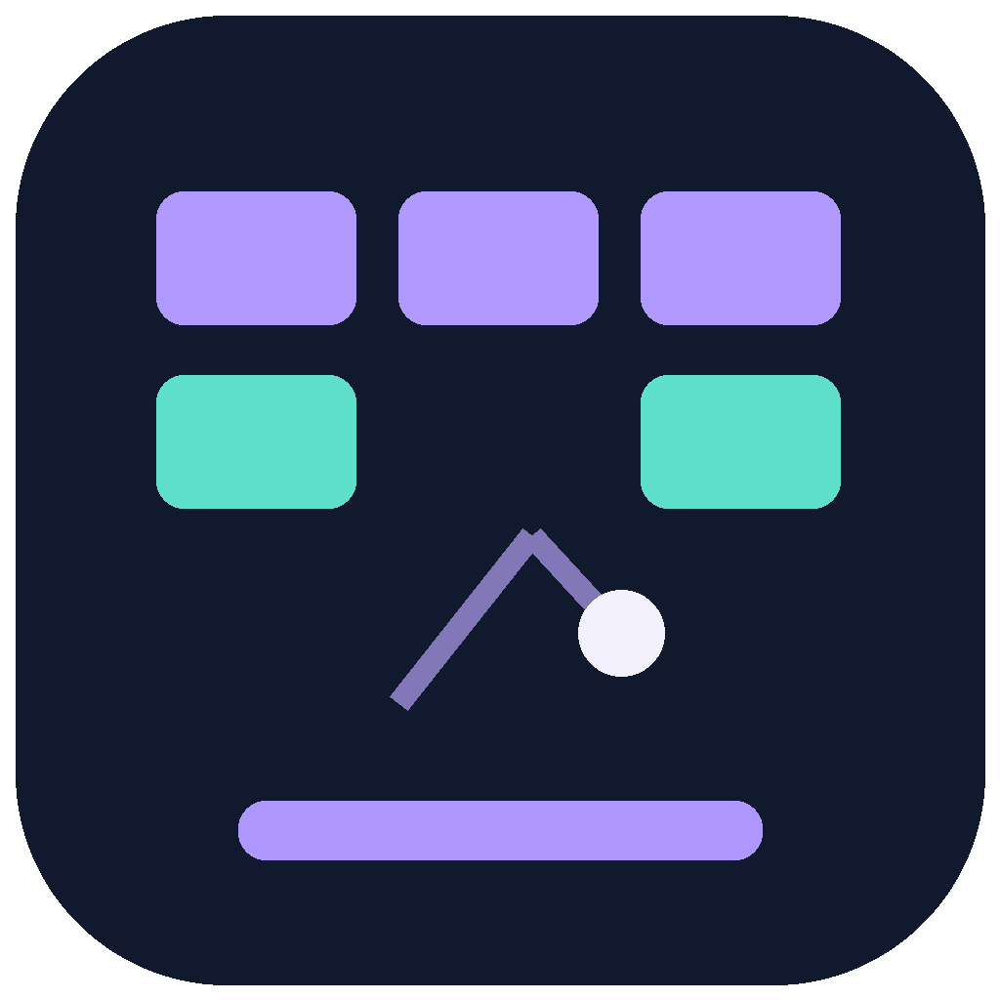
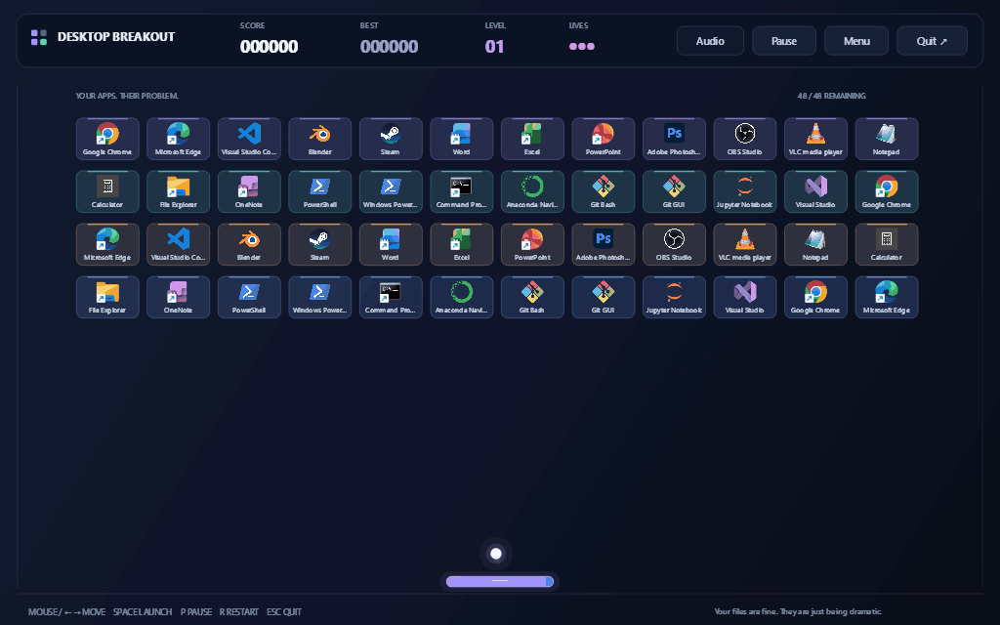
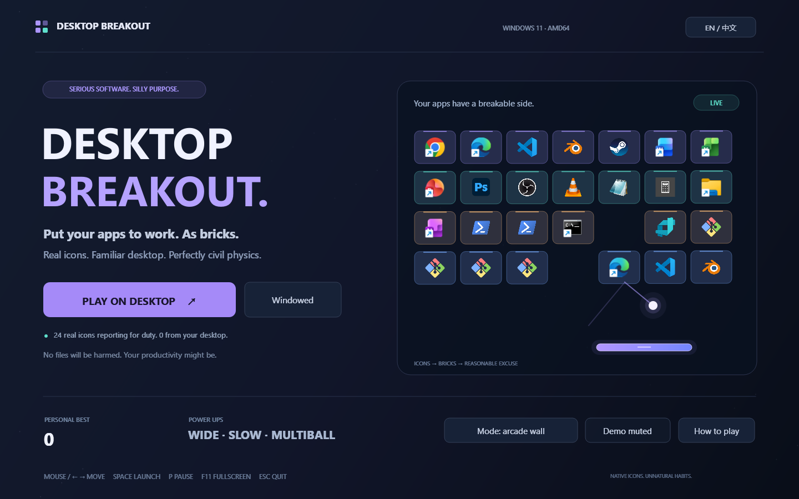
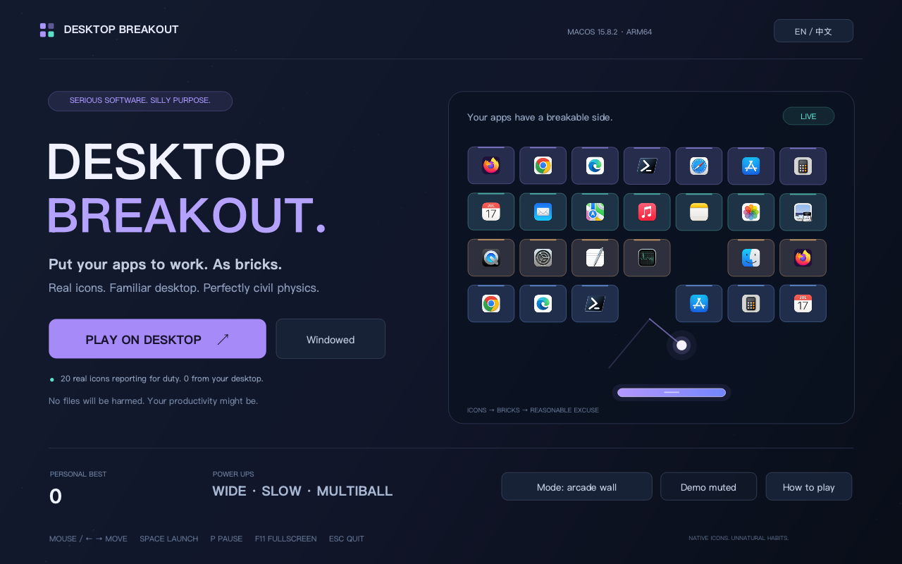

<div align="center">



# Desktop Icon Breakout
### 桌面图标打砖块

**Your icons have been reassigned to brick duty. Effective immediately.**

**English** · [简体中文](README.md) · [Download](https://github.com/Manfredss/desktop-icon-breakout/releases/latest) · [Controls](#mandatory-30-second-onboarding)

[](https://github.com/Manfredss/desktop-icon-breakout/actions/workflows/build.yml)

[](LICENSE)

</div>



> **This is Breakout, not an uninstaller.**<br>
> Smash Chrome. Keep Chrome. Smash Word. Still have to write that document.

Turn your **real desktop icons** into a brick wall. Move the paddle, catch the ball, and negotiate a brief ceasefire with productivity. Suspiciously tidy desktop? The game recruits **apps already installed on your computer**. English / Chinese, windowed / fullscreen, endless levels, three lives. HR has been informed.

## Download. Unzip. Procrastinate.

Open **[Latest Release](https://github.com/Manfredss/desktop-icon-breakout/releases/latest)** and pick your platform:

| Your computer | Download | Run |
|---|---|---|
| Windows 10 / 11, 64-bit | `…windows-x64.zip` | Extract **the whole ZIP**, double-click `DesktopIconBreakout.exe` |
| Mac, Apple Silicon | `…macos-arm64.zip` | Unzip and open `DesktopIconBreakout.app` |
| Mac, Intel | `…macos-x64.zip` | Unzip and open `DesktopIconBreakout.app` |
| Linux, x86-64 | `…linux-x64.tar.gz` | Extract, then run `./DesktopIconBreakout` inside its folder |

**Release bundles include the runtime. No Python, .NET, or admin rights required.** Keep the extracted folder intact. Mac bundles are ad-hoc signed, but not Developer ID signed or notarized; source instructions below are an alternative if macOS blocks them. Linux targets desktop systems with glibc 2.35+ (such as Ubuntu 22.04+); system graphics drivers are not bundled.

Windows has been played on a real desktop. See the Build check for macOS/Linux build and startup results. Desktop themes, distributions, and monitor setups vary; this is not a claim that every machine has been tested.

## Mandatory 30-second onboarding

| Task | Controls |
|---|---|
| Move paddle | Mouse, `←` `→`, or `A` `D` |
| Launch / resume / next level | Click, `Space`, or `Enter`, as prompted |
| Pause / restart | `P` / `R` |
| Toggle fullscreen | `F11` |
| Return to gainful employment | `Esc` |
| Switch language | `中文 / EN` in the menu |

Where the ball hits the paddle determines its bounce angle. Chain hits for combo points and clear the wall to advance. Changing windows pauses the game automatically. Even the ball knows when to look busy.

| Pickup | Benefit approved by management |
|---|---|
| `↔` Wider paddle | A larger margin for error |
| `S` Slow ball | A reasonable accommodation for your reflexes |
| `×3` Multiball | Finally, a legitimate reason to multitask |



## Every icon has a verifiable employment history

**No invented app logos, OS-themed imitation packs, or downloaded logo collections.** Platform detection selects the native reading method. Your brick wall depends on what your machine actually has installed.

| Platform | Where backup recruits come from |
|---|---|
| Windows | User/public Start Menu shortcuts and built-in system applications |
| macOS | `.app` bundles in `/Applications`, `/System/Applications`, and user Applications |
| Linux | XDG `.desktop` entries and their installed icon themes, including Flatpak / Snap locations |

Desktop icons come first. Fewer than 24? Installed apps fill the vacancies, up to 80 icons total. If necessary, authentic icons are reused in the wall. Unreadable icons are skipped. Available native system icons are labeled as system sources. If none can be read, the game asks you to check the desktop/theme rather than inventing a “Neon Quantum Folder.”

Icons are arranged into a playable wall; **their real desktop coordinates are not preserved**. Fullscreen uses an independent game window on the current display, not one field spanning multiple monitors. A readable local wallpaper can become the backdrop; unsupported environments and dynamic wallpapers use the game's plain background.

<details>
<summary>Actual Mac rendering: same game, different native recruits</summary>



Rendered by the running application on a GitHub-hosted Apple Silicon Mac. All 20 icons came from apps installed on that Mac. The Intel Mac build passed the same check.

</details>

## Your files are safe. Your afternoon is negotiable.

- Reads icon artwork, application names, and local wallpaper. Does not launch the underlying apps or documents.
- Does not delete, move, rename, or rearrange desktop files. Does not hide Explorer or Finder.
- The game has no networking, accounts, telemetry, or score uploads. Scores/preferences stay in the local app configuration directory.
- `--demo` uses an allowlist of installed apps and native system icons. It excludes personal desktop filenames/wallpaper and never writes personal settings.

**The GIF above is rendered by the actual game with real installed-app icons and an automated paddle. It is not a mockup or a human high score.** Public demos use a plain backdrop. Software marks belong to their respective owners and imply no endorsement.

## Run from source

Python 3.10–3.13 required. Download and extract the repository ZIP, or clone it, then open a terminal in the folder containing `app.py` and `requirements.txt`.

**Windows / PowerShell**

```powershell
python -m venv .venv
.\.venv\Scripts\python -m pip install -r requirements.txt
.\.venv\Scripts\python app.py
```

**macOS / Linux**

```sh
python3 -m venv .venv
.venv/bin/python -m pip install -r requirements.txt
.venv/bin/python app.py
```

Force a language: `app.py --lang en` or `app.py --lang zh`. Public demo: `app.py --demo`.

**Develop, test, package**

```sh
python -m pip install -r requirements-dev.txt
python -m pytest -q
python tools/build.py
```

Build on the target OS; archives appear in `release/`. GitHub Actions builds Windows, Mac Apple Silicon, Mac Intel, and Linux separately. Checks cover physics, native-icon parsing, and offscreen rendering of the actual UI. Downloads include SHA-256 checksum files.

On Windows, the build script isolates the child process's DLL search path so an editor's bundled OpenSSL cannot conflict with Python's version. System environment variables stay unchanged.

## FAQ

**I only have two desktop icons.** Installed apps fill the wall. Repeated appearances do not create copies of your real files.

**Where is my favorite app?** Only readable local icons are used. Missing/hidden/broken shortcuts and remote `.url` / UNC artwork are skipped.

**No icons or wallpaper on Linux?** Install a desktop icon theme such as Adwaita. Wallpaper lookup covers Windows, macOS, GNOME/Cinnamon, and XFCE; other environments can use the plain backdrop. If graphics libraries are missing, install your distribution's Qt/X11/Wayland system dependencies.

If Ubuntu/Debian reports missing `libxcb-shape.so.0`, install `sudo apt install libxcb-shape0`. The build environment includes this dependency and verifies actual UI and packaged-app startup under an X11 virtual display.

**No sound on Mac/Linux?** Synthesized sound is currently Windows-only. Other platforms explicitly show muted audio; all game rules work.

**Found a bug?** Open an [issue](https://github.com/Manfredss/desktop-icon-breakout/issues) with the OS version, desktop environment, and reproduction steps. Check screenshots for personal filenames before posting.

## Credit where the chaos is due

Inspired by [liuxiaogang-com / desktop-icon-billiards](https://github.com/liuxiaogang-com/desktop-icon-billiards). If the desktop can host a pool hall, it can support a brick department.

This is an independently written Breakout implementation inspired by its use of authentic desktop icons; no source code was copied. Thank you for the delightfully impractical idea.

[MIT](LICENSE) · [Third-party libraries and icon notices](THIRD_PARTY_NOTICES.md)
