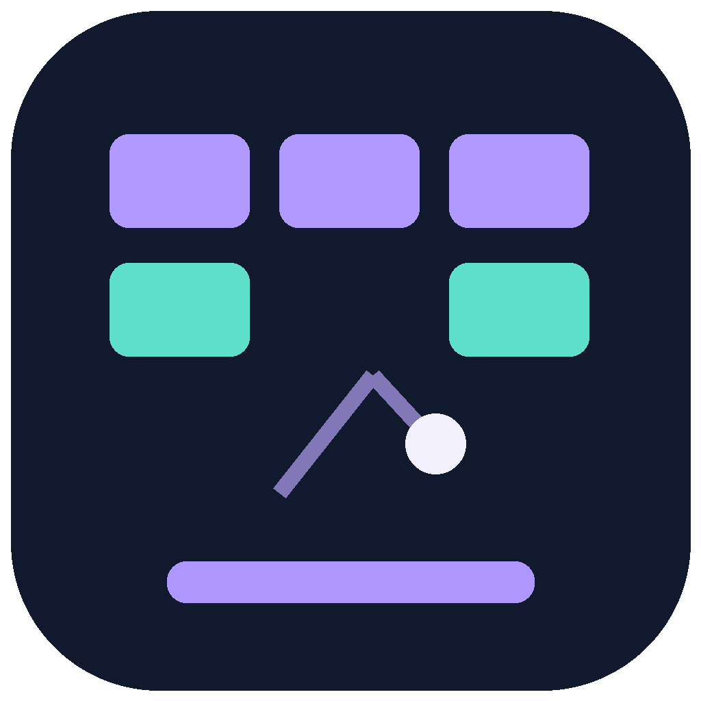
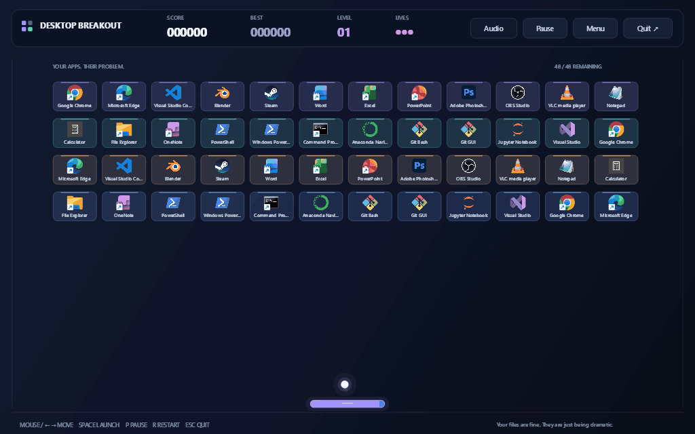
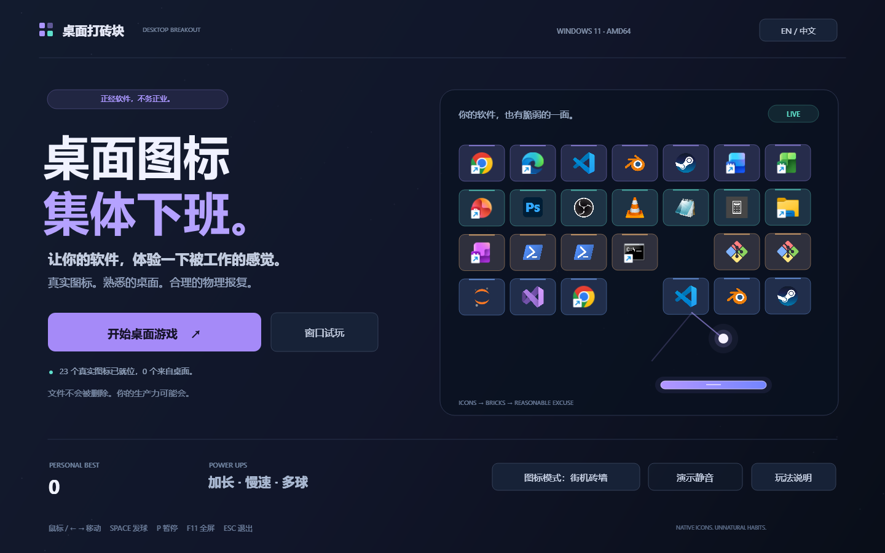
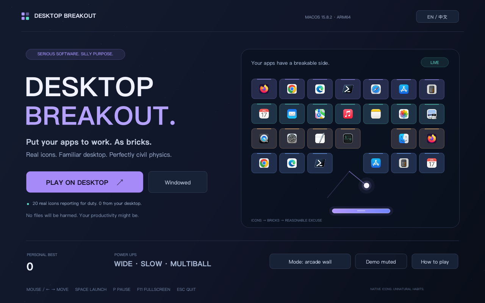

<div align="center">



# 桌面图标打砖块
### Desktop Icon Breakout

**经研究决定：您的软件图标，今日调任砖块。**<br>
*Your icons have been reassigned to brick duty. Effective immediately.*

[English](README.en.md) · **简体中文** · [下载 / Download](https://github.com/Manfredss/desktop-icon-breakout/releases/latest) · [操作说明](#快速上手)

[](https://github.com/Manfredss/desktop-icon-breakout/actions/workflows/build.yml)

[](LICENSE)

</div>



> **这是一款打砖块游戏，不是一款卸载工具。**<br>
> 看哪个软件不爽直接击碎！工作什么的再说

把桌面上的**真实图标**变成砖墙，用鼠标移动挡板接球。桌面太干净？从**本机已安装的软件**借点人手。支持中文 / English、窗口 / 全屏、连续关卡，以及三次机会

## 下载即玩

到 **[最新版本 Releases](https://github.com/Manfredss/desktop-icon-breakout/releases/latest)**，按系统选择：

| 你的电脑 | 下载这个文件 | 然后 |
|---|---|---|
| Windows 10 / 11，64 位 | `…windows-x64.zip` | **完整解压**，双击 `DesktopIconBreakout.exe` |
| Mac，Apple 芯片 | `…macos-arm64.zip` | 解压，打开 `DesktopIconBreakout.app` |
| Mac，Intel 芯片 | `…macos-x64.zip` | 解压，打开 `DesktopIconBreakout.app` |
| Linux，x86-64 | `…linux-x64.tar.gz` | 解压，在文件夹内运行 `./DesktopIconBreakout` |

**发行包自带运行环境，不需要 Python、不需要 .NET、不需要管理员权限。** 请保留解压后的整个文件夹。Mac 版本仅作临时签名，尚未使用 Developer ID 签名或公证；若系统阻止打开，可以选择下方的源码运行方式。Linux 包面向 glibc 2.35+ 桌面系统（如 Ubuntu 22.04+），不包含系统图形驱动。

Windows 已在真实桌面试玩（参考配置：9800X3D + 5070Ti, win11 home）；macOS 和 Linux 的自动构建及启动结果见上方 Build。各桌面主题、发行版和显示器组合欢迎反馈。

## 快速上手

| 操作 | 按键 |
|---|---|
| 移动挡板 | 鼠标，或 `←` `→` / `A` `D` |
| 发球 / 继续 / 下一关 | 单击，或 `Space` / `Enter`（按当前画面提示） |
| 暂停 / 重开 | `P` / `R` |
| 窗口与全屏 | `F11` |
| 退出，恢复正常劳动关系 | `Esc` |
| 切换语言 | 菜单中的 `中文 / EN` |

打中挡板的不同位置，反弹角度也会变化。连续击中得连击分，清空砖墙后进入下一关。切换到别的窗口会自动暂停——老板来了，小球也懂事。

| 掉落道具 | 作用 |
|---|---|
| `↔` 加长挡板 | 临时扩大接球面积，招人不如加宽工位 |
| `S` 慢速球 | 给反应速度一个体面的台阶 |
| `×3` 多球 | 同时处理多个任务，终于有了合理的解释 |



## 有理有据

**不生成假软件图标也不联网下载商标包。** 系统信息用于选择本机读取方式；每台电脑生成的砖墙，取决于本机装了什么。

| 平台 | 如果桌面图标不足怎么办 |
|---|---|
| Windows | 当前用户与公共开始菜单中的软件快捷方式、系统自带程序 |
| macOS | `/Applications`、`/System/Applications`、用户 Applications 中的 `.app` |
| Linux | XDG 应用目录中的 `.desktop` 文件及其实际安装的图标主题，兼顾 Flatpak / Snap |

桌面图标优先，少于 24 个时用本机应用补齐，最多读取 80 个。仍不足时允许重复使用已有真实图标；读取不到的图标直接跳过。可用的系统原生图标会标记为系统来源。若一个都读不到，会提示检查图标主题或桌面快捷方式，不会临时发明一个“霓虹宇宙文件夹”。

目前会把图标排成可玩的砖墙，**不会保留它们在真实桌面上的原始坐标**。全屏是一层独立游戏窗口，支持当前屏幕，不把多个显示器拼成球场。壁纸可用时作为背景；不支持的桌面环境或动态壁纸使用游戏默认背景。

<details>
<summary>看看 Mac 上的真实运行画面：同一款游戏，另一批原生图标</summary>



由 GitHub 的 Apple Silicon Mac 实际运行并渲染，20 个图标均来自该 Mac 已安装的应用。Intel Mac 也已通过相同验证。

</details>

## 文件安全，生产力另说

- 只读取图标外观、应用名称和本地壁纸；不打开图标所指向的软件或文档。
- 不删除、移动、改名任何桌面文件，不修改桌面布局，不隐藏 Explorer / Finder。
- 游戏不联网，无账户、无遥测、无排行榜上传。最高分与偏好只保存在本机应用配置目录。
- `--demo` 演示模式只选常见已安装软件和系统图标，不读取桌面文件名、个人壁纸，也不写个人设置。

**上方 GIF 是实际游戏渲染，使用本机真实软件图标和自动接球演示** 发布演示使用纯色背景，实际使用背景因人而异

## 从源码运行

需要 Python 3.10–3.13。先下载仓库 ZIP 并解压，或 `git clone` 本仓库，然后在包含 `app.py` 和 `requirements.txt` 的目录打开终端。

**Windows（PowerShell）**

```powershell
python -m venv .venv
.\.venv\Scripts\python -m pip install -r requirements.txt
.\.venv\Scripts\python app.py
```

**macOS / Linux**

```sh
python3 -m venv .venv
.venv/bin/python -m pip install -r requirements.txt
.venv/bin/python app.py
```

指定语言：`app.py --lang zh` / `app.py --lang en`。公开演示：`app.py --demo`。

**开发、测试、打包**

```sh
python -m pip install -r requirements-dev.txt
python -m pytest -q
python tools/build.py
```

在目标系统上打包，产物放到 `release/`。GitHub Actions 分别构建 Windows、Mac Apple Silicon、Mac Intel 和 Linux，并执行物理测试、原生图标测试和实际界面离屏渲染。发布包附带 SHA-256 校验文件。

Windows 打包脚本会为构建子进程隔离 DLL 搜索路径，避免编辑器附带的 OpenSSL 与 Python 的版本冲突；不会修改系统环境变量。

## 常见问题

**桌面只有两三个图标，还能玩？** 能。真实已安装软件会补位；同一软件可以多次出场，但不会在桌面复制文件。

**怎么没有某个软件？** 只使用实际能读取的本地图标；未安装、隐藏或损坏的快捷方式、远程 `.url` / UNC 图标会跳过。

**Linux 没有图标 / 壁纸？** 需要可用的桌面图标主题，例如 Adwaita。壁纸读取目前覆盖 Windows、macOS、GNOME / Cinnamon 和 XFCE；其他环境可正常玩默认背景。Linux 图形库缺失时，请安装发行版的 Qt/X11/Wayland 运行所需系统库。

若 Ubuntu / Debian 报缺少 `libxcb-shape.so.0`，安装 `sudo apt install libxcb-shape0`。构建环境已包含此依赖，并用 X11 虚拟显示器验证实际窗口与发行包启动。

**Mac / Linux 为什么没声音？** 当前合成音效仅 Windows 提供；其他系统会明确显示静音，玩法完整。

**想报告问题？** 在 [Issues](https://github.com/Manfredss/desktop-icon-breakout/issues) 附系统版本、桌面环境和复现步骤即可。公开截图前留意个人文件名。

## 致谢

灵感来自 [liuxiaogang-com / desktop-icon-billiards](https://github.com/liuxiaogang-com/desktop-icon-billiards)：既然桌面能开台球厅，也应该允许成立砖块事业部。

这是独立编写的打砖块实现，参考了其“读取真实桌面图标来玩游戏”的思路，没有复制其源码。感谢原作者的奇思妙想。

[MIT](LICENSE) · [第三方库与图标说明](THIRD_PARTY_NOTICES.md)
